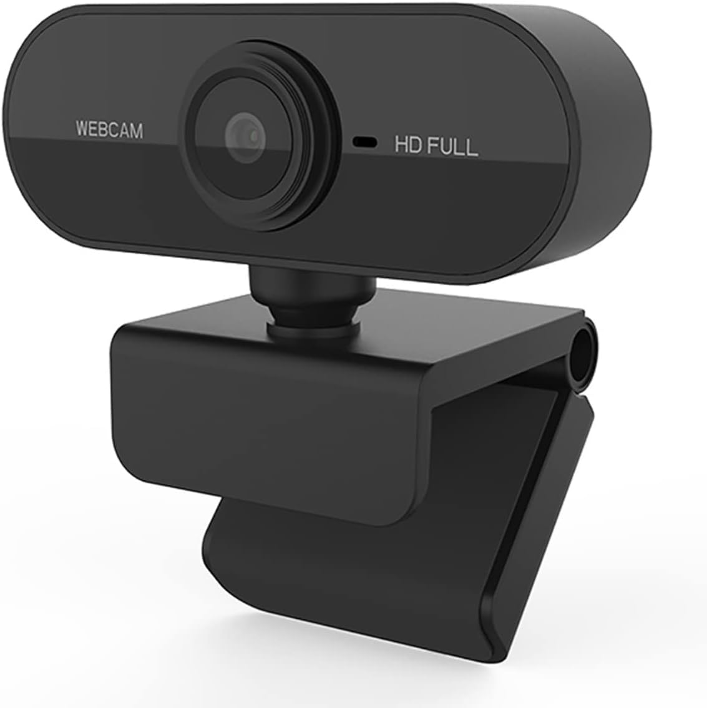
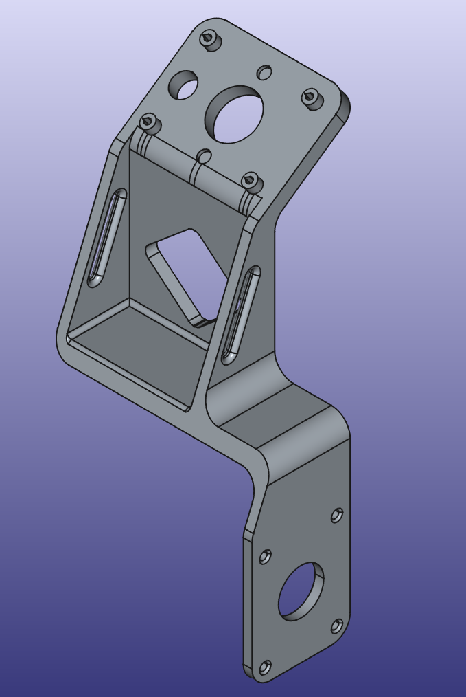
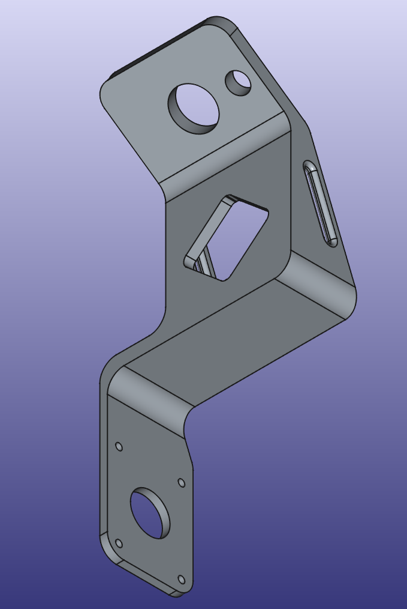
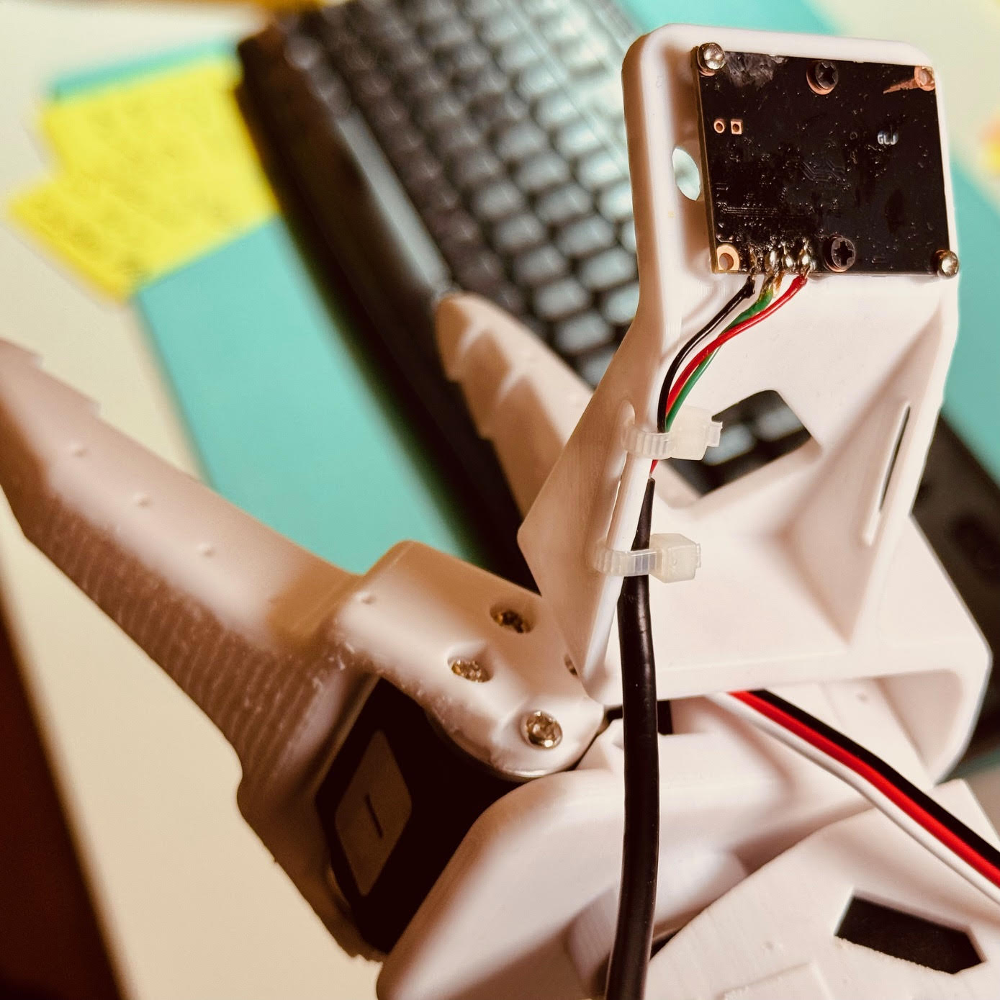
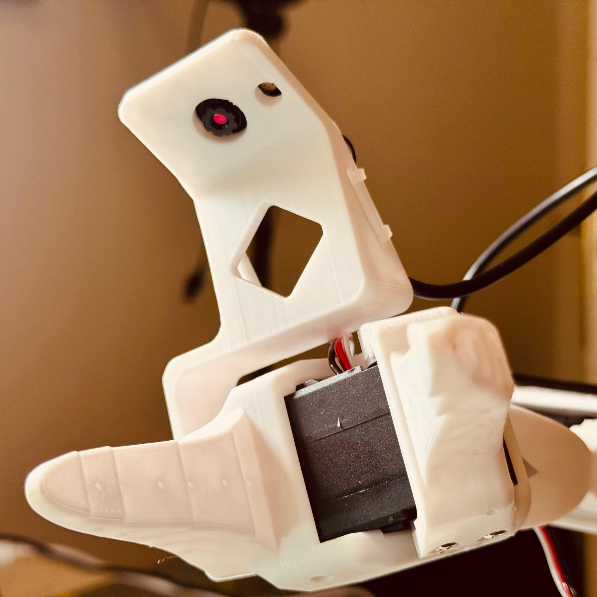
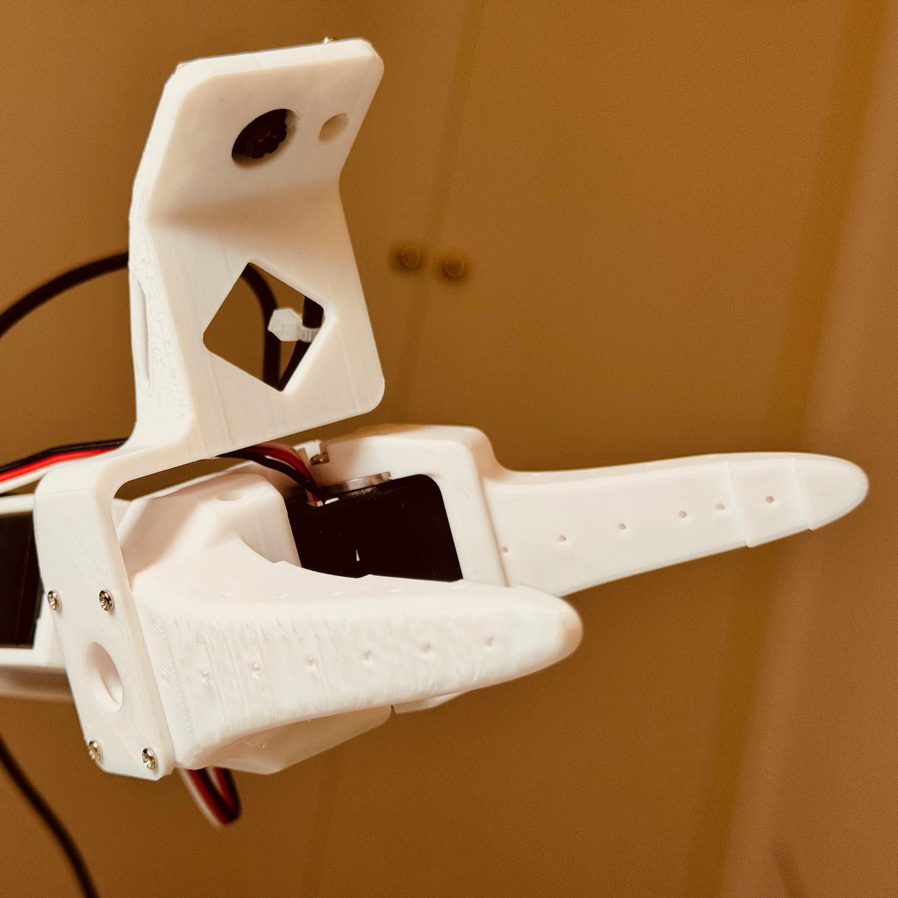
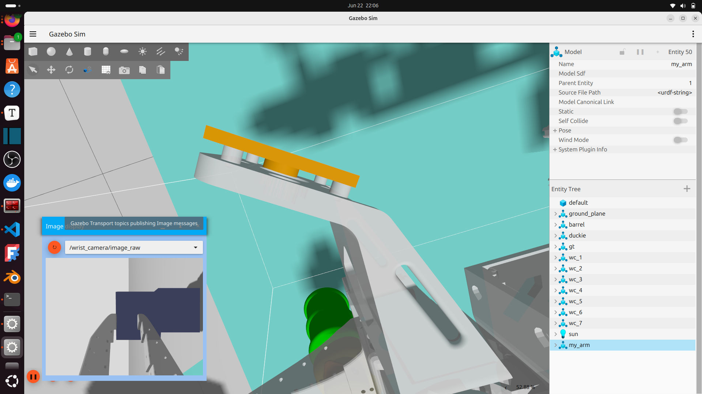

# Camera

## Stripping the camera

## Designing a Wrist Mount

Designed in FreeCAD, 3D printed

|  |  |
| ----------------------------------- | ----------------------------------- |

## 3D printing

Print on the side. Assemble with 4 of the extra self-tapping screws from the servo kits. Use tieraps to secure camera cable to the robot ensuring enough slack in all arm positions.  

|  |  |  |
| ------------------------- | ------------------------- | ------------------------- |

## Add wrist camera mount to the simulation

In folder `v3_export_to_gazebo` - scale down `my_wrist_camera_mount_v3` x1000 to transform units from mm to m, place it in position relative to `Fixed_Jaw.STL` and export both files together

`Fixed_Jaw_w_cam_mount_v3.STL` - STL export from `fixed_jaw_with_wrist_camera_mount_v3.FCStd` to load as mesh

In `urdf/my_arm.urdf.xacro`:

 * load `Fixed_Jaw_w_cam_mount_v3.STL` instead of `Fixed_Jaw.STL` mesh both in `<visual>` and `<collision>`
 * adjust origin to properly align camera with mount: 

    -        <origin xyz="-0.05 0.0 0.01" rpy="0 ${-pi/2+0.4} 0 " />
    +        <origin xyz="-0.082 0.002 0.044" rpy="0 ${-pi/2+0.95} 0 " />

