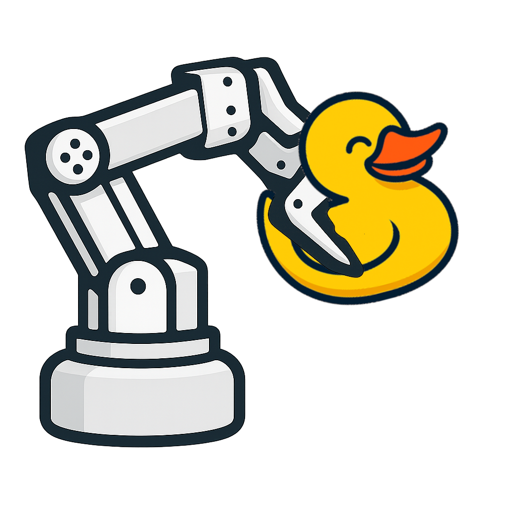
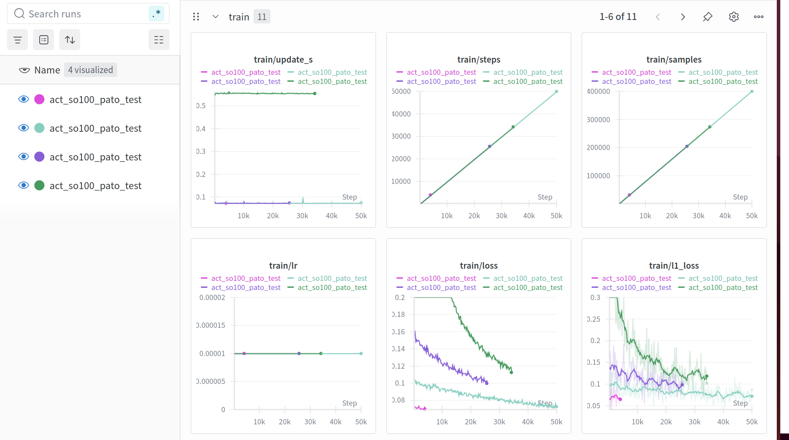
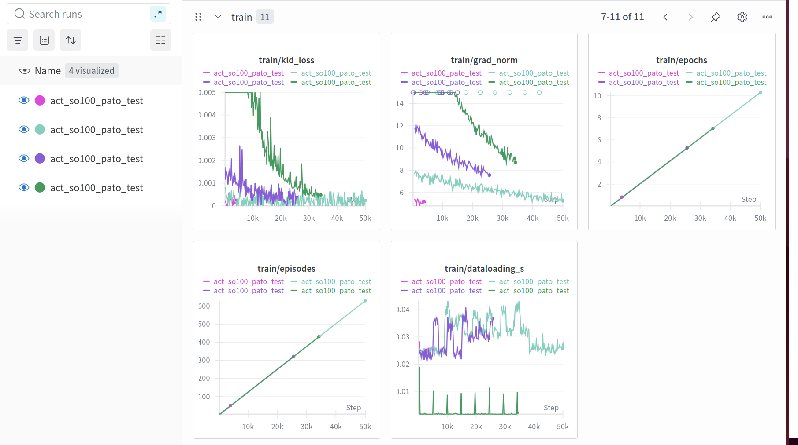

<div align="left"><picture></picture></div>


# Python, un robot y un patito de goma

Log of my second try at training the SOARM100 with lerobot for the talk "Python, un robot y un patito de goma" at PyConEs2025

Todo: 

- [ ] add pics and videos

## Notes

Since I originally used the setup there had been breaking changes in the repo so I had to renumber the motors from 6-1 to 1-6 using the FE-URT-1 board under windows - check instructions [here](./Configuring_the_Servos.md).  While calibrating the leader, I accidentally run the servos and this messed the calibration of the arm ( the control goes on an infinite loop the encoder sees a difference with the target, the control tries to move the servo but the gears are removed and it cannot close the difference)

I had merge conflicts between the modifications I added during pycamp and the evolution of the repo, eventually decided to delete and reinstall lerobot

## Quick Start

- switch on power supply
- connect the usb-c of follower arm FIRST and THEN connect the usb-c of leader arm (to ubuntu assigns `/dev/ttyACM0` to the follwer and `/dev/ttyACM1` to the leader)
- teleoperate without camera:

```bash
$ conda activate lerobot
(lerobot)$ lerobot-teleoperate \
    --robot.type=so100_follower \
    --robot.port=/dev/ttyACM0 \
    --robot.id=my_follower_arm \
    --teleop.type=so100_leader \
    --teleop.port=/dev/ttyACM1 \
    --teleop.id=my_leader_arm
```

## First Setup

### setup conda

Sources: https://huggingface.co/docs/lerobot/en/installation and https://huggingface.co/docs/lerobot/so100

install `miniconda`:

```bash
$ mkdir -p ~/miniconda3
$ wget https://repo.anaconda.com/miniconda/Miniconda3-latest-Linux-x86_64.sh -O ~/miniconda3/miniconda.sh
$ bash ~/miniconda3/miniconda.sh -b -u -p ~/miniconda3
$ rm ~/miniconda3/miniconda.sh
```

source and initialize `conda`:

```bash
$ source ~/miniconda3/bin/activate
$ conda init --all
```

to prevent conda for launching automatically:

```bash
$ conda config --set auto_activate_base false
```

create a virtual environment with python 3.10, activate it and install `ffmpeg`:

```bash
$ conda create -y -n lerobot python=3.10
$ conda activate lerobot
(lerobot)$ conda install ffmpeg -c conda-forge
```

### Install lerobot (from source) 

Clone the repo:

```bash
(lerobot)$ git clone https://github.com/huggingface/lerobot.git
(lerobot)$ cd lerobot
```

install dependencies and lerobot:

```bash
(lerobot)$ sudo apt-get install cmake build-essential python3-dev pkg-config libavformat-dev libavcodec-dev libavdevice-dev libavutil-dev libswscale-dev libswresample-dev libavfilter-dev pkg-config
(lerobot)$ pip install -e ".[feetech]"
```

###  Connect the arms

Connect follower first then leader arm while checking ports live with

```bash
(lerobot)$ watch -n 1 ls /dev/ttyACM*
```

### Calibrate

#### Follower arm

```bash
(lerobot)$ lerobot-calibrate \
    --robot.type=so100_follower \
    --robot.port=/dev/ttyACM0 \
    --robot.id=my_follower_arm
    
INFO 2025-09-16 23:02:01 calibrate.py:73 {'robot': {'calibration_dir': None,
           'cameras': {},
           'disable_torque_on_disconnect': True,
           'id': 'my_follower_arm',
           'max_relative_target': None,
           'port': '/dev/ttyACM0',
           'use_degrees': False},
 'teleop': None}
INFO 2025-09-16 23:02:01 follower.py:104 my_follower_arm SO100Follower connected.
INFO 2025-09-16 23:02:01 follower.py:121 
Running calibration of my_follower_arm SO100Follower
Move my_follower_arm SO100Follower to the middle of its range of motion and press ENTER....
Move all joints except 'wrist_roll' sequentially through their entire ranges of motion.
Recording positions. Press ENTER to stop...

-------------------------------------------
-------------------------------------------
NAME            |    MIN |    POS |    MAX
shoulder_pan    |    651 |   2016 |   3162
shoulder_lift   |    911 |    912 |   3225
elbow_flex      |    831 |   3063 |   3073
wrist_flex      |    834 |   2907 |   3288
gripper         |   2044 |   2056 |   3487
Calibration saved to /home/mhered/.cache/huggingface/lerobot/calibration/robots/so100_follower/my_follower_arm.json
INFO 2025-09-16 23:03:06 follower.py:232 my_follower_arm SO100Follower disconnected.
```

#### Leader arm

```bash
(lerobot)$ lerobot-calibrate \
    --teleop.type=so100_leader \
    --teleop.port=/dev/ttyACM1 \
    --teleop.id=my_leader_arm
   
INFO 2025-09-16 23:07:18 calibrate.py:73 {'robot': None,
 'teleop': {'calibration_dir': None,
            'id': 'my_leader_arm',
            'port': '/dev/ttyACM1'}}
INFO 2025-09-16 23:07:18 00_leader.py:81 my_leader_arm SO100Leader connected.
INFO 2025-09-16 23:07:18 00_leader.py:98 
Running calibration of my_leader_arm SO100Leader
Move my_leader_arm SO100Leader to the middle of its range of motion and press ENTER....
Move all joints except 'wrist_roll' sequentially through their entire ranges of motion.
Recording positions. Press ENTER to stop...

-------------------------------------------
-------------------------------------------
NAME            |    MIN |    POS |    MAX
shoulder_pan    |    881 |   1837 |   3204
shoulder_lift   |    975 |    976 |   3269
elbow_flex      |    803 |   3015 |   3015
wrist_flex      |    652 |   2822 |   3116
gripper         |   2043 |   2046 |   2959
Calibration saved to /home/mhered/.cache/huggingface/lerobot/calibration/teleoperators/so100_leader/my_leader_arm.json
INFO 2025-09-16 23:08:20 0_leader.py:159 my_leader_arm SO100Leader disconnected.
```

Note calibration data is now saved to:

`/home/mhered/.cache/huggingface/lerobot/calibration/robots/so100_follower/my_follower_arm.json`

`/home/mhered/.cache/huggingface/lerobot/calibration/teleoperators/so100_leader/my_leader_arm.json`

### Teleoperate

```bash
(lerobot)$ lerobot-teleoperate \
    --robot.type=so100_follower \
    --robot.port=/dev/ttyACM0 \
    --robot.id=my_follower_arm \
    --teleop.type=so100_leader \
    --teleop.port=/dev/ttyACM1 \
    --teleop.id=my_leader_arm
```

This command will automatically:

1. Identify any missing calibrations and initiate the calibration procedure.
2. Connect the robot and teleop device and start teleoperation.

### Setup cameras

Source: https://huggingface.co/docs/lerobot/en/cameras

Find camera indexes with:

```bash
(lerobot)$ lerobot-find-cameras opencv

--- Detected Cameras ---
Camera #0:
  Name: OpenCV Camera @ /dev/video0
  Type: OpenCV
  Id: /dev/video0
  Backend api: V4L2
  Default stream profile:
    Format: 0.0
    Width: 640
    Height: 480
    Fps: 30.0
--------------------
Camera #1:
  Name: OpenCV Camera @ /dev/video2
  Type: OpenCV
  Id: /dev/video2
  Backend api: V4L2
  Default stream profile:
    Format: 0.0
    Width: 640
    Height: 360
    Fps: 40.0
--------------------
Camera #2:
  Name: OpenCV Camera @ /dev/video4
  Type: OpenCV
  Id: /dev/video4
  Backend api: V4L2
  Default stream profile:
    Format: 0.0
    Width: 640
    Height: 480
    Fps: 30.0
--------------------
Camera #3:
  Name: OpenCV Camera @ /dev/video6
  Type: OpenCV
  Id: /dev/video6
  Backend api: V4L2
  Default stream profile:
    Format: 0.0
    Width: 640
    Height: 480
    Fps: 30.0
--------------------

Finalizing image saving...
Image capture finished. Images saved to outputs/captured_images

```

Identify cameras by looking at the images stored in the `outputs/captured_images` folder

In this case `/dev/video4` is `head_cam` and `/dev/video6` is `top_cam`

### Teleop (& visualize) with cameras 

```bash
(lerobot)$ lerobot-teleoperate \
    --robot.type=so100_follower \
    --robot.port=/dev/ttyACM0 \
    --robot.id=my_follower_arm \
    --robot.cameras="{ head_cam: {type: opencv, index_or_path: 4, width: 640, height: 480, fps: 30}, top_cam: {type: opencv, index_or_path: 6, width: 640, height: 480, fps: 30}}" \
    --teleop.type=so100_leader \
    --teleop.port=/dev/ttyACM1 \
    --teleop.id=my_leader_arm \
    --display_data=true
```

### Setup HuggingFace token 

Source: https://huggingface.co/docs/lerobot/en/il_robots

get a token, add to the repo credential, and store HF repo name in a variable:

```bash
(lerobot)$ hf auth login --token hf_**...** --add-to-git-credential
Token is valid (permission: fineGrained).
The token `vader-pycon` has been saved to /home/mhered/.cache/huggingface/stored_tokens
Your token has been saved in your configured git credential helpers (store).
Your token has been saved to /home/mhered/.cache/huggingface/token
Login successful.
The current active token is: `vader-pycon`

(lerobot)$ HF_USER=$(hf auth whoami | awk '{print $NF}') # awk used to extract last field of command output
(lerobot)$ echo $HF_USER
mhered
```

### Record a couple of episodes (init repo)

Source: https://huggingface.co/docs/lerobot/en/il_robots

```bash
(lerobot)$ lerobot-record \
  --robot.type=so100_follower \
  --robot.port=/dev/ttyACM0 \
  --robot.id=my_follower_arm \
  --robot.cameras="{ head_cam: {type: opencv, index_or_path: 4, width: 640, height: 480, fps: 30}, top_cam: {type: opencv, index_or_path: 6, width: 640, height: 480, fps: 30} }" \
  --teleop.type=so100_leader \
  --teleop.port=/dev/ttyACM1 \
  --teleop.id=my_leader_arm \
  --display_data=true \
  --dataset.repo_id=${HF_USER}/recording-test \
  --dataset.num_episodes=3 \
  --dataset.episode_time_s=30 \
  --dataset.reset_time_s=15 \
  --dataset.single_task="Grab a duckie"
```

Control the data recording flow using keyboard shortcuts:

- Press **Right Arrow (`→`)**: Early stop the current episode or reset time and move to the next.
- Press **Left Arrow (`←`)**: Cancel the current episode and re-record it.
- Press **Escape (`ESC`)**: Immediately stop the session, encode videos, and upload the dataset.

Add more episodes (resume recording):

```bash
(lerobot)$ lerobot-record \
  --robot.type=so100_follower \
  --robot.port=/dev/ttyACM0 \
  --robot.id=my_follower_arm \
  --robot.cameras="{ head_cam: {type: opencv, index_or_path: 4, width: 640, height: 480, fps: 30}, top_cam: {type: opencv, index_or_path: 6, width: 640, height: 480, fps: 30} }" \
  --teleop.type=so100_leader \
  --teleop.port=/dev/ttyACM1 \
  --teleop.id=my_leader_arm \
  --display_data=true \
  --dataset.repo_id=${HF_USER}/recording-test \
  --dataset.num_episodes=5 \
  --dataset.episode_time_s=50 \
  --dataset.reset_time_s=10 \
  --dataset.single_task="Grab a duckie" \
  --resume=true


```

Advice:

- look only at the camera feeds: if it is difficult for you to complete the task looking only at camera feeds it will be difficult for the model
- keep leader arm, moving background out of the camera field of view
- Record 60 episodes
  * first ~20 in roughly the same position
  * ~20 changing starting positions of duckie and barrel
  * ~20 varying also the lighting and the color of the barrel to add robustness and avoid overfitting

## Training

When finished recording train using the [ACT training notebook](https://huggingface.co/docs/lerobot/en/notebooks#training-act) in Collab.

My version here: https://github.com/mhered/robotica_patito_pycon2025/blob/main/lerobot/training-act.ipynb

The notebook has cells to install conda, lerobot, setup wandb.ai and start training.

I created an account in wandb.ai with Google OAuth SPAM, organization Duckietown 

Note: Before running any cells, select A100 GPU runtime type (requires making a purchase, the cheapest option of 100 units pay as you go  for ~10€ will be plenty. 1-2hrs of training expected).

Note: If you stop before a checkpoint you cannot resume, lose progress, by default  does first checkpoint 20k steps!!

```bash
$ lerobot-train \
  --dataset.repo_id=mhered/recording-test \
  --policy.type=act \
  --output_dir=outputs/train/act_so100_pato_test1 \
  --job_name=act_so100_pato_test \
  --policy.device=cuda \
  --wandb.enable=true \
  --policy.repo_id=mhered/my_act
```

## Check progress in wandb.ai

https://wandb.ai/spam-mhered-duckietown/lerobot/workspace?nw=nwuserspammhered





### Losses

- **`train/loss`** – the **total objective** used to update the model each step.
   For ACT+VAE it’s roughly:
   `total ≈ l1_loss + kl_weight * kld_loss` (you had `kl_weight=10.0`).
- **`train/l1_loss`** – **reconstruction error** (L1) between predicted actions (or decoded targets) and the demo ground truth. Lower is better.
- **`train/kld_loss`** – **KL divergence** term from the VAE. Often logged **unscaled**; the scaled piece contributes to `train/loss`. Too low (≈0) can mean the latent isn’t used; too high hurts fit.

### Optimization/throughput

- **`train/grad_norm`** – global gradient L2 norm. You clip at `grad_clip_norm` (e.g., 10). Constant clipping → try a slightly smaller LR or check instability.
- **`train/dataloading_s`** – **seconds per step spent loading/decoding data**. If this approaches `update_s`, the **DataLoader is your bottleneck** → reduce workers, cache locally, smaller images, fewer cams, etc.
- **`update_s`** – **seconds per optimization step** (forward+backward+optimizer). Should drop on A100 vs T4 and with AMP.

### Progress counters

- **`train/epochs`** – effective **passes over the dataset** (`samples_processed / dataset_size`). In your console this is `epch`.
- **`train/episodes`** – number of **trajectory demos** traversed so far (your dataset had ~61). In the console log this shows as `ep`.
- **`train/steps`** – **optimizer steps** taken (what triggers `save_freq`/`eval_freq`).
- **`train/samples`** – cumulative **training examples** processed (think “windows/batches,” not raw frames).

### Other

- **`lr`** – current **learning rate** (constant if no scheduler; otherwise it changes over time).

### What “good” looks like

- `train/l1_loss` and total `train/loss` trending **down**.
- `train/kld_loss` settling to a small non-zero value (scaled by `kl_weight` inside total).
- `train/grad_norm` not constantly at the clip ceiling.
- `train/dataloading_s` noticeably **smaller** than `update_s`.

## ChatGPT assessment:

Overall this looks **healthy** :

- **Losses drop cleanly.** `train/loss` and `train/l1_loss` trend down across runs; no divergence.
- **KLD behaves.** `train/kld_loss` decays to a small non-zero value. With `kl_weight=10`, the latent is heavily regularized; for a single pick-and-place that’s fine, but it does mean the L1 term dominates.
- **Gradients are stable.** `train/grad_norm` starts high (~14–15), then eases to ~5–8 → fewer/softer clips; good signal the model settled.
- **Throughput is compute-bound.** `train/update_s` ~0.55s/step on the slower run vs ~0.08s/step on the fast one (A100/AMP). `train/dataloading_s` ~0.02–0.04s, well below `update_s`, so the loader isn’t your bottleneck.
- **Progress counters are sane.** `steps`, `samples`, `epochs` rise linearly; by 50k steps you’re ~10 epochs over ~61 episodes.

### Suggestions (actionable)

1. **Keep AMP + A100.** You’re getting ~7× faster steps; perfect.
2. **Checkpoint cadence:** every **5k** is a good balance (you already set that).
3. **If plateaus appear after ~30–40k:**
   - Try a short **fine-tune**: drop LR ×0.5–0.3 for the last 10–20k steps.
   - Or freeze the vision backbone for a few k steps, then unfreeze (sometimes sharpens the head).
4. **KLD weight** (optional tweak): with a single, simple task you can keep `kl_weight=10`. If you want the latent to carry more info (less collapse), try **5 → 2** and compare `kld_loss`/performance.
5. **Batch size:** on A100 you can likely go **batch 16** (maybe 32) if memory allows; watch `grad_norm` for stability.
6. **Validation signal:** add an **eval/rollout success metric** (or hold-out episodes). Training curves look good, but only eval tells you when to stop.

### TL;DR

Loss down, grads stable, data not the bottleneck, A100 is paying off. I’d continue to ~50–60k steps (or until eval stops improving), keep 5k saves, and consider a small LR drop near the end. If you want, share a quick eval success plot and I’ll tell you where I’d stop exactly.


## Evaluate policy

```bash
(lerobot) $ 
```

---


